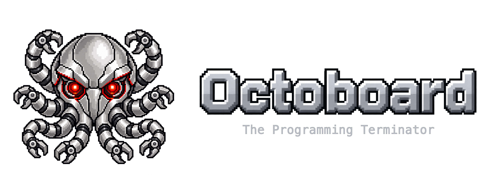
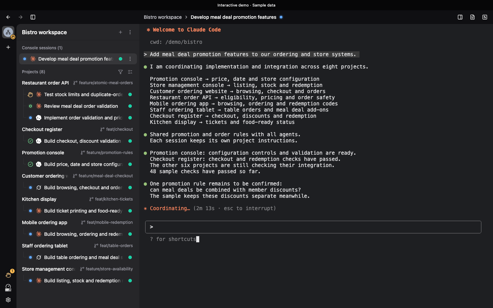

# Octoboard

<p align="center">
  
</p>

<p align="center">Programming ends here. Power to rival the Terminator.</p>

**Your agents. Your accounts. One workspace.**

Octoboard is a local, open source development workspace for **Claude Code**, **Codex**, and **Grok Build**.
Bring your existing agents and accounts together, switch accounts while keeping the conversation, and hand tasks
between providers. Work on one project or choose an agent to coordinate work across several projects.

[Website](https://octoboard.dev/) · [Interactive preview](https://octoboard.dev/#product-preview) ·
[Releases](https://github.com/baijunjie/octoboard/releases)

[](https://octoboard.dev/#product-preview)

*Actual application UI with sample data. Try the project overview, focus mode, and code review on the website.*

## Features

### Accounts and usage

- **Manage multiple accounts.** View sign-in status, usage, and reset times in one place. Enable automatic account
  selection to choose an available account for a new session based on its status and reset times.
- **Switch accounts and continue.** Move a session to another account of the same agent while keeping its conversation
  and task context.
- **Recover from usage limits.** Enable automatic account switching to continue interrupted work on another available
  account of the same agent. If none is available, wait until a fresh usage reading confirms quota recovery to resume.

### Context and continuity

- **Watch context usage.** See context size and window usage when reported by the agent, and pass the next stage to a
  fresh session before the conversation gets too long.
- **Keep earlier conversations available.** Revisit or resume an old session while the original agent still has its
  conversation record, including to ask about earlier decisions.
- **Hand work to another provider.** Give the next agent a handoff record of the task, current progress, and remaining
  work so it can take over.

### Agents and projects

- **Coordinate across projects.** A coordinating agent assigns work, follows dependencies, and brings reports together.
  Choose the agent for the coordinator and each project independently.
- **Keep each project's setup.** Each project runs an independent native session in its own directory, loading its
  instructions, Skills, Hooks, and MCP configuration through the chosen agent's own mechanisms.
- **Follow the work and step in.** See who is working and who needs your input. Open any assigned project session to
  add context or steer the work, and browse project files and Git diffs to review the changes.

For example, a meal deal promotion can span an order API, an administration console, and customer apps. Give the goal
to a coordinator, let each project agent work with its own context, and follow their progress from one workspace.

## Getting started

**Octoboard is in beta, still in development.** Features and workflows are still being refined.

1. Install and configure the coding-agent CLIs you want to use: Claude Code, Codex, or Grok Build.
2. Check the [macOS releases](https://github.com/baijunjie/octoboard/releases) for an available build, or use the
   [development setup](#develop) below to run from source.
3. Add an existing project folder without moving your code. The default account uses your existing CLI configuration;
   additional accounts use separate configurations with optional sharing of supported settings.
4. Open a project session with your chosen agent and account. For work spanning projects, open a console session and
   ask its agent to coordinate the relevant projects.

Octoboard is free under the MIT License. Agents and model services use your own accounts and follow the subscriptions
or billing terms of the providers you choose. If your agent supports a self-hosted model, you can keep that setup.

## Platform support

| Form | Status |
|---|---|
| macOS app (Apple silicon and Intel, macOS 11 or later) | Beta, still in development |
| Linux server — the daemon on a headless server, the interface in a browser on the network | Planned |
| Windows app | Planned |
| iOS app | Planned |
| Android app | Planned |

The desktop window, daemon, and projects currently share one machine. Linux is planned as a server for one person
accessing their own daemon through a browser; there is no Linux desktop app planned. Server deployment and running
project agents on remote hosts are not available yet. Multiple users sharing one daemon are outside this design.

## FAQ

**Do I need to configure my projects again?**

Add the folders you already use. Your agent still loads its project instructions and tools. See
[Launching agents](docs/product/launching-agents.md) for how the existing CLI setup is used.

**Where do my code and conversations go?**

Octoboard stores its application data locally and does not upload your code or conversations to servers operated by
its developer. Your configured agents and tools may send data to their providers, and collaboration may share task
information with multiple providers. See the [privacy policy](https://octoboard.dev/privacy/) for details.

**Can parallel sessions conflict?**

Sessions share the project folder by default, so simultaneous edits to the same file can conflict. For parallel work,
ask the agents to use separate Git worktrees and review the changes before merging.

**Can I return to the original CLI?**

Yes. Project files stay in their original folders. While the original agent still has a conversation record, you can
resume it through that agent's CLI. With an additional account, launch the CLI using that account's configuration
directory.

More questions about collaboration and setup are answered on [the website](https://octoboard.dev/#questions).

## Develop

You need macOS, Node.js with pnpm, a Rust toolchain, and the agent CLIs you want to use. Octoboard launches the agents
from your shell environment; those agents are yours, including one you point at a model you host yourself. How a launch
is configured is in [Launching agents](docs/product/launching-agents.md).

```sh
pnpm install                                  # Install the workspace (and, in the main checkout, the git hooks).
pnpm --filter @octoboard/desktop build:daemon  # Build the daemon sidecar once (and again after daemon changes).
pnpm --filter @octoboard/desktop tauri dev     # Start the UI dev server and open the desktop window on it.
```

Each part has its own entry doc with the rest of its first-time flow:

| Part | What it is | Entry doc |
|---|---|---|
| `apps/desktop/` | The macOS desktop application (Tauri 2 shell) | [apps/desktop/README.md](apps/desktop/README.md) |
| `apps/daemon/` | `octoboardd`, the Rust daemon that owns agent processes and data | [apps/daemon/README.md](apps/daemon/README.md) |
| `packages/ui/` | The React + HeroUI interface, also runnable in a browser | [packages/ui/README.md](packages/ui/README.md) |
| `apps/web/` | The public website at octoboard.dev (Nuxt) | [apps/web/README.md](apps/web/README.md) |

The git hooks format staged files on commit and run the affected checks on push; `pnpm verify --dry-run` shows which
checks a change selects and `pnpm verify` runs them. How the checks are scoped is in
[scripts/verify/README.md](scripts/verify/README.md).

Where to read next: the [documentation index](docs/README.md) answers which doc to open for which question, the
[project map](docs/project-map.md) gives the technology stack and directory map, and
[architecture](docs/architecture.md) explains why it is built this way.

## This is an AI-native project

Octoboard is built around the belief that developers can spend their time on requirements, decisions, testing, and
product outcomes while AI handles implementation. Quality is judged through thorough testing against real needs.

Every line of code in this repository is written by AI. Humans set the direction, review the result, and decide
what gets built — they do not hand-write the code.

- **Pull requests are not accepted.** Any PR will be closed without review.
- **[Open an issue](https://github.com/baijunjie/octoboard/issues) instead.** Describe the bug, the missing
  capability, or the idea. Once an issue is accepted, an AI agent is assigned to implement it.

## License

[MIT](LICENSE)
