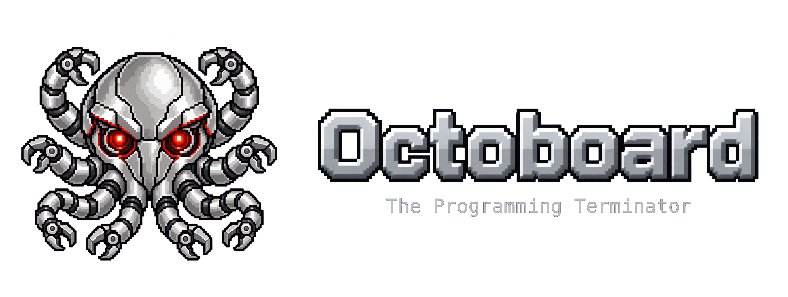

# Octoboard

<p align="center">
  
</p>

Octoboard is a local, open source command center for coding agents: it runs on your own machine, or on a server
of yours, never as a service someone else hosts.

Octoboard is for large projects inside a company. One product is split across repositories, each
with its own rules and often its own agent. A change rarely stays in one of them. Agent workspace tools
today usually load every project's Skills and tools into a single session and develop all of those projects
there. Their contexts get mixed, and the quality of the work becomes unpredictable. Even then, that session can
miss another project's instructions. Split the work into one session per project instead, and you end up
copying context and relaying results yourself.

Octoboard starts a native session in each project directory, so that project keeps its own agent,
instructions, and tools. A coordinating agent splits the work, hands each project its part, and brings the
reports back together. You can still open any project conversation and work with its agent directly.

The full introduction is on [octoboard.dev](https://octoboard.dev).

**Status: early development.** The macOS app for Apple Silicon is still in development. Only the first
prototype features are in place, and the details are still being refined.

Octoboard comes in two forms. In the desktop app, the window, the daemon and the projects share one machine.
On a server, the daemon alone runs on a machine without a display, and you reach the same interface from a
browser on another machine over the network. Linux is the server form: there is no Linux desktop app. The
server form is the same person reaching their own daemon from elsewhere — one user with a server of their
own, not a team sharing one; several people on one daemon are outside this design.

| Form | Status |
|---|---|
| macOS app (Apple Silicon) | Early prototype, still in development |
| Linux server — the daemon on a headless server, the interface in a browser on the network | Planned |
| Windows app | Planned |
| iOS app | Planned |
| Android app | Planned |

## Develop

Install the agent CLIs you want to use. Octoboard launches them from your shell environment. Those agents are
yours, including one you point at a model you host yourself. How a launch is configured is in
[Launching agents](docs/product/launching-agents.md).

Build and run the desktop app from the
[desktop development guide](apps/desktop/README.md#development): install the workspace, build the daemon sidecar,
then start Tauri.

### Code quality

Run these commands from the repository root after installing the workspace:

```sh
pnpm format       # Apply ESLint layout fixes and format both Rust crates.
pnpm lint         # Check JavaScript, TypeScript, TSX and Vue; warnings fail the check.
pnpm format:check # Check ESLint rules and Rust formatting without changing files.
pnpm typecheck
```

ESLint checks source code and scripts across the workspace. ESLint Stylistic uses two-space indentation,
double quotes and semicolons; Vue template rules handle the website's single-file components. Rust formatting
uses the root `rustfmt.toml`; CI runs rustfmt from Rust 1.86.0. Generated files, dependencies and build output
are excluded. CSS, JSON, Markdown and other file types are outside the ESLint formatting scope.

Use `pnpm lint:fix` separately to apply available lint fixes, then inspect the changes and run the relevant
tests. For routine edits, format only the files or Rust packages involved in the task:

```sh
pnpm exec eslint path/to/file.tsx --fix --fix-type layout
cargo fmt -p octoboardd
```

The Code quality workflow checks ESLint and Rust formatting on pushes to `main` and pull requests. Formatting
does not replace type checking, tests or code review.

The desktop shell is [Tauri 2](https://github.com/tauri-apps/tauri) around a
[React](https://github.com/facebook/react) and [HeroUI](https://github.com/heroui-inc/heroui) interface. A
[Rust](https://github.com/rust-lang/rust) daemon, `octoboardd`, owns agent processes and application data.
Terminals render with [xterm.js](https://github.com/xtermjs/xterm.js). The UI talks to the daemon over
WebSocket/HTTP only. Where to read next: [project map](docs/project-map.md),
[architecture](docs/architecture.md), [documentation index](docs/README.md).

## This is an AI-native project

Every line of code in this repository is written by AI. Humans set the direction, review the result, and decide
what gets built — they do not hand-write the code.

- **Pull requests are not accepted.** Any PR will be closed without review.
- **[Open an issue](https://github.com/baijunjie/octoboard/issues) instead.** Describe the bug, the missing
  capability, or the idea. Once an issue is accepted, an AI agent is assigned to implement it.

## License

[MIT](LICENSE)
