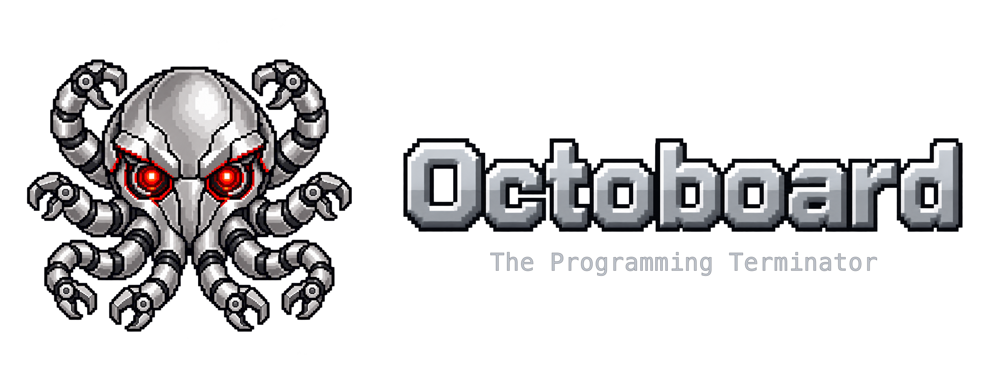
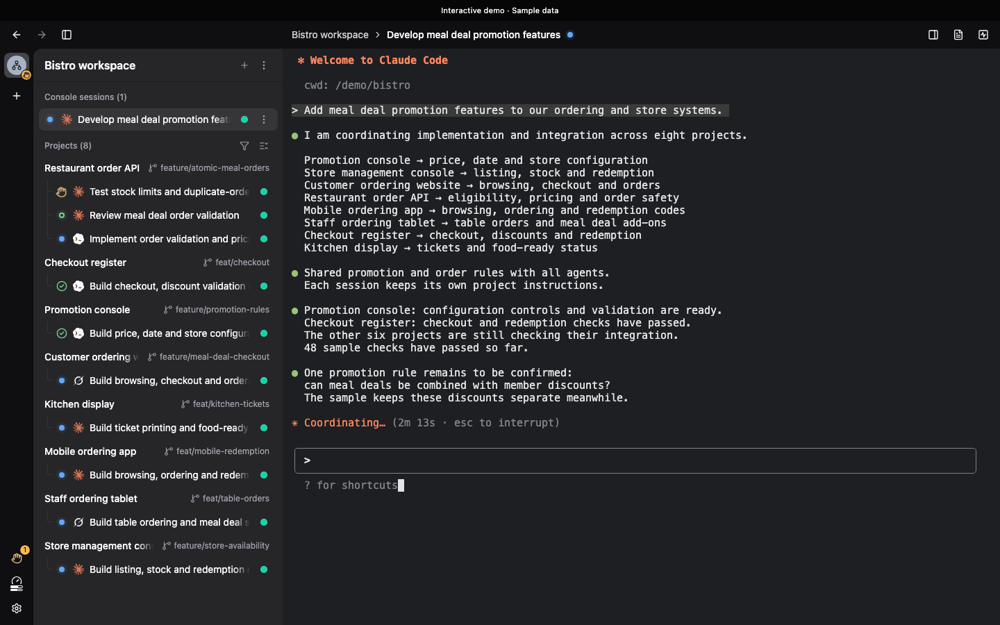

# Octoboard

<p align="center">
  
</p>

<p align="center">Programming ends here. Power to rival the Terminator.</p>

<p align="center">
  <a href="apps/desktop/package.json"></a>
  <a href="#platform-support"></a>
  <a href="https://v2.tauri.app/"></a>
  <a href="LICENSE"></a>
</p>

**Your agents. Your accounts. One workspace.**

Octoboard is a local, open source development workspace for **Claude Code**, **Codex**, **Grok Build**, **Antigravity CLI**, **GitHub Copilot CLI**, **OpenCode**, **Qwen Code**, and **Pi**.
Bring your existing agents and accounts together, switch accounts while keeping the conversation, and hand tasks
between providers. Work on one project or choose an agent to coordinate work across several projects.

[Website](https://octoboard.dev/) · [Interactive preview](https://octoboard.dev/#product-preview) ·
[Releases](https://github.com/baijunjie/octoboard/releases)

[](https://octoboard.dev/#product-preview)

*Actual application UI with sample data. Try the project overview, focus mode, and code review on the website.*

## Features

### Accounts and usage

- **Manage multiple accounts.** View sign-in status, usage, and reset times in one place. Enable automatic account
  selection to choose an available account for a new session based on its status and reset times.
- **Switch accounts and continue.** Move a session to another account of the same agent while keeping its conversation
  and task context.
- **Recover from usage limits.** Enable automatic account switching to continue interrupted work on another available
  account of the same agent. If no account is available, Octoboard waits and automatically resumes the task once updated
  usage data confirms that an account has recovered its quota.

### Context and continuity

- **Watch context usage.** See context size and window usage when reported by the agent, and pass the next stage to a
  fresh session before the conversation gets too long.
- **Keep earlier conversations available.** Revisit or resume an old session while the original agent still has its
  conversation record, including to ask about earlier decisions.
- **Hand work to another provider.** Give the next agent a handoff record of the task, current progress, and remaining
  work so it can take over.

### Agents and projects

- **Coordinate across projects.** A coordinating agent assigns work, follows dependencies, and brings reports together.
  Choose the agent for the coordinator and each project independently.
- **Keep each project's setup.** Each project runs an independent native session in its own directory, loading its
  instructions, Skills, Hooks, and MCP configuration through the chosen agent's own mechanisms.
- **Follow the work and step in.** See who is working and who needs your input. Open any assigned project session to
  add context or steer the work, and browse project files and Git diffs to review the changes.

For example, a meal deal promotion can span an order API, an administration console, and customer apps. Give the goal
to a coordinator, let each project agent work with its own context, and follow their progress from one workspace.

## Getting started

**Octoboard is in beta, still in development.** Features and workflows are still being refined.

1. Install and configure the coding-agent CLIs you want to use: Claude Code, Codex, Grok Build, Antigravity CLI, GitHub Copilot CLI, OpenCode, Qwen Code, or Pi.
2. Download the newest version of the app for [macOS](https://octoboard.dev/download/macos/) (a `.dmg`) or
   [Windows](https://octoboard.dev/download/windows/) (an installer; see [Installing on Windows](#installing-on-windows)),
   or pick one from the [releases](https://github.com/baijunjie/octoboard/releases). On a Linux server, install the
   daemon instead (see [Installing on a Linux server](#installing-on-a-linux-server)). Or use the
   [development setup](#develop) below to run from source.
3. Add an existing project folder without moving your code. The default account uses your existing CLI configuration;
   additional accounts use separate configurations with optional sharing of supported settings.
4. Open a project session with your chosen agent and account. For work spanning projects, open a console session and
   ask its agent to coordinate the relevant projects.

Octoboard is free under the MIT License. Agents and model services use your own accounts and follow the subscriptions
or billing terms of the providers you choose. If your agent supports a self-hosted model, you can keep that setup.

## Platform support

| Form | Status |
|---|---|
| macOS app (Apple silicon and Intel, macOS 11 or later) | Beta, still in development |
| Windows app (x64, Windows 10 21H2 or later) | Beta, still in development |
| Linux server (x86_64 and aarch64, any distribution) — the daemon on a headless server, the interface in a desktop app or browser over SSH | Beta, still in development |
| iOS app | Planned |
| Android app | Planned |

The desktop app can open its local daemon and remote daemons in separate windows. Connect over SSH to a Linux
server or to another Mac or Windows PC running Octoboard. You can also reach a remote daemon from a browser over
an SSH forward. Projects and agents run on the machine hosting their daemon. Each daemon is for its owner.

### Installing on Windows

- **Download**: `Octoboard_<version>_x64-setup.exe`, or `Octoboard_<version>_arm64-setup.exe` for Windows 11 on Arm,
  from a [release](https://github.com/baijunjie/octoboard/releases). It installs Octoboard for your user account only;
  later versions arrive through the app's own updates.
- **Requirements**: Windows 10 version 21H2 or later on x64, or Windows 11 on Arm with the native arm64 build; Windows
  11 is the version it has been tested on. The installer downloads and installs Microsoft Edge WebView2 if it is
  missing, which needs an internet connection.
- **Agents**: install the agent CLIs you want to use, as on macOS. On Windows, Octoboard supports Claude Code, Codex,
  Grok Build, Antigravity CLI, GitHub Copilot CLI, OpenCode, Qwen Code, and Pi. Claude Code and Codex also need
  [Git for Windows](https://gitforwindows.org/). Sharing the default account's configuration with additional accounts
  needs Windows' Developer Mode turned on (then quit Octoboard and open it again); without it, sharing is unavailable
  and each additional account keeps a configuration of its own.
- **Unsigned for now**: the first Windows releases are not code-signed, so Microsoft Defender SmartScreen may show
  "Windows protected your PC" when you run the installer. Select **More info**, then **Run anyway** to install it.
  Code signing is planned for a later release.

### Installing on a Linux server

Install `octoboardd`, the daemon with the interface inside it, for your user (no root needed):

```sh
curl --proto '=https' --tlsv1.2 -fsSL https://octoboard.dev/install.sh | sh
```

It installs into `~/.local/bin`, checking the download's SHA-256 and its signature (with `minisign`, or on an upgrade
with the installed `octoboardd`; a first install without `minisign` warns that it checked the SHA-256 alone, and
`sh -s -- --require-signature` refuses to go on without the signature check).
Then start the daemon and print the address to open:

```sh
octoboardd start      # Start the daemon in the background; its own port is one the system assigns.
octoboardd address
```

If the installer says `~/.local/bin` is not on your `PATH`, use the full path it prints or add that directory
to your `PATH`, for example in `~/.profile`.

`octoboardd address` also prints the `ssh -L` command that forwards the daemon's owner-only socket
(`~/.octoboard/browser.sock`) to port 3369 on your own machine. `octoboardd browser on` also opens a loopback browser
port, 3369 by default, for a browser on the server or a tool such as `tailscale serve`; it is off until you turn it on,
and on a server other people share, any of them can take that port while the daemon is not running. Replace `<server>` in that command with the address
your machine uses to reach the server, run it on your machine and open the printed browser address.
To have the daemon start at boot as a systemd user service instead, install with `--service`, which needs systemd:

```sh
curl --proto '=https' --tlsv1.2 -fsSL https://octoboard.dev/install.sh | sh -s -- --service   # Starts the service; add --port <port> to give the daemon's own port.
loginctl enable-linger "$USER"   # Only if the script says lingering is off: keeps the service running after logout and starts it at boot.
```

- **Upgrade**: run the install command again, then `octoboardd restart`; the sessions keep running.
- **Without the script**: download the archive for [x86_64](https://octoboard.dev/download/linux-x86_64/) or
  [aarch64](https://octoboard.dev/download/linux-aarch64/), check it against its `.sha256` from the
  [release](https://github.com/baijunjie/octoboard/releases), and put `octoboardd` on your `PATH`. The archive also holds
  the example systemd unit.
- **Requirements**: Linux on x86_64 or aarch64; the binary is statically linked and needs no particular distribution or
  C library. Install the agent CLIs you want to use on the server.

More about the daemon on a server is in [apps/daemon/README.md](apps/daemon/README.md).

### Connecting the desktop app to a server

The macOS and Windows apps open a server's daemon in a window of its own, over SSH. Nothing listens on the network
beyond the server's SSH: whoever can log in over SSH as the daemon's user can use the daemon.

1. On the server, as the user the daemon runs as, with the daemon running (`octoboardd start` or the service), print
   the connection details:

   ```sh
   octoboardd connection
   ```

   It prints a QR code and one line, `octoboard+ssh://<user>@<host>:<port>?fingerprint=…&octoboardd=…`, holding the
   host, SSH port, user, the fingerprint of the server's SSH host key and where `octoboardd` is; no password or key.
   Run over SSH, it takes the address that session reached the server at; otherwise the server's own name, which other
   machines may not know. When your devices reach the server at another name or port, say so:
   `octoboardd connection --host server.example.com --ssh-port 2222`. `--text` prints the line alone. The QR code holds
   the same line. No client scans it yet.
2. In the app, open the **Remote devices** page: the Remote devices button in the main window's rail, or **Remote
   Devices** (macOS: the **Remote** menu or the Dock menu; Windows: the window's system menu, opened from its title bar
   icon or with Alt+Space, or the taskbar icon's jump list). Press **Add remote daemon** and paste the line into
   **Connection details** (its Paste button reads the clipboard): it fills the host, port, user, name and the path of
   `octoboardd`, and pins the host key, so a server that shows another key is refused. Choose a password or one of your
   SSH key files, save, and connect; that daemon then opens in a window of its own. Without the
   details, type the host, port and user in; the app then shows the server's host key at the first connection and pins
   it once you confirm it, which you can check against `ssh-keygen -lf /etc/ssh/ssh_host_ed25519_key.pub` on the
   server. After the first sign-in the app asks whether to add an SSH key of its own for this device, naming the line
   and the file it would add it to; if you agree it signs in with that key from then on, and if you do not it keeps
   signing in as you chose and does not ask again. No password is stored.
3. **Removing a device**: a device is let in by the SSH key it signs in with. Removing the remote daemon in the app,
   or turning **This computer's key** off on its page, takes the app's key out of the server's file and off the
   device; where the server cannot be reached, the app names the line for you to delete. To shut a device out from the
   server itself, delete its line from `~/.ssh/authorized_keys` of the daemon's user; a key the app installed ends
   with `Octoboard on <device name>`. A connection already open lasts until it drops. A browser address you gave out
   is shut out separately, with `octoboardd address --rotate`.

The daemon keeps running when the app quits or the window closes: a remote window only disconnects.

### Connecting to another computer's desktop app

Another computer's macOS or Windows app can be a host too, the same way, through that computer's own SSH server:

1. On the host computer, in the app's **Settings › Access**, turn on **Allow remote access**, and turn on the
   computer's SSH server as the section guides you (macOS: Remote Login; Windows: OpenSSH Server). While remote access
   is on, the section shows the connection details, as text and as a QR code, with the path of the app's own
   `octoboardd`. The host in them is the computer's own name: correct it on the other device if that device reaches
   the computer at another name or address.
2. On the other device, paste the details into **Connection details** when adding a remote daemon, as for a server.
   A Windows host's default SSH shell may be the command prompt or PowerShell; either works.
3. The host's daemon runs only while its app does: keep the app running on the host (it may run in the background).
   Removing a device is removing its key, as for a server; on a Windows host the key of an administrator is in
   `%ProgramData%\ssh\administrators_authorized_keys`, any other user's in `%USERPROFILE%\.ssh\authorized_keys`.

## FAQ

**Do I need to configure my projects again?**

Add the folders you already use. Your agent still loads its project instructions and tools. See
[Launching agents](docs/product/launching-agents.md) for how the existing CLI setup is used.

**Where do my code and conversations go?**

Octoboard stores its application data locally and does not upload your code or conversations to servers operated by
its developer. Your configured agents and tools may send data to their providers, and collaboration may share task
information with multiple providers. See the [privacy policy](https://octoboard.dev/privacy/) for details.

**Can parallel sessions conflict?**

Sessions share the project folder by default, so simultaneous edits to the same file can conflict. For parallel work,
ask the agents to use separate Git worktrees and review the changes before merging.

**Can I return to the original CLI?**

Yes. Project files stay in their original folders. While the original agent still has a conversation record, you can
resume it through that agent's CLI. With an additional account, launch the CLI using that account's configuration
directory.

More questions about collaboration and setup are answered on [the website](https://octoboard.dev/#questions).

## Develop

You need macOS, Node.js with pnpm, a Rust toolchain, and the agent CLIs you want to use. Octoboard launches the agents
from your shell environment; those agents are yours, including one you point at a model you host yourself. How a launch
is configured is in [Launching agents](docs/product/launching-agents.md).

```sh
pnpm install                                  # Install the workspace (and, in the main checkout, the git hooks).
pnpm --filter @octoboard/desktop build:daemon  # Build the daemon sidecar once (and again after daemon changes).
pnpm --filter @octoboard/desktop tauri dev     # Start the UI dev server and open the desktop window on it.
```

Each part has its own entry doc with the rest of its first-time flow:

| Part | What it is | Entry doc |
|---|---|---|
| `apps/desktop/` | The desktop application for macOS and Windows (Tauri 2 shell) | [apps/desktop/README.md](apps/desktop/README.md) |
| `apps/daemon/` | `octoboardd`, the Rust daemon that owns agent processes and data | [apps/daemon/README.md](apps/daemon/README.md) |
| `packages/ui/` | The React + HeroUI interface, also runnable in a browser | [packages/ui/README.md](packages/ui/README.md) |
| `apps/web/` | The public website at octoboard.dev (Nuxt) | [apps/web/README.md](apps/web/README.md) |

The git hooks format staged files on commit and run the affected checks on push; `pnpm verify --dry-run` shows which
checks a change selects and `pnpm verify` runs them. How the checks are scoped is in
[scripts/verify/README.md](scripts/verify/README.md).

The root commands cover the repository as a whole:

| Command | Purpose |
|---|---|
| `pnpm verify` | Run the checks selected by the changed files; `--dry-run` shows the plan. |
| `pnpm lint` | Lint JavaScript, TypeScript and Vue across the repository; add `--fix` to apply lint fixes. |
| `pnpm format` | Format supported source files across the repository with ESLint and rustfmt. |
| `pnpm format:staged` | Format only staged source files, preserving unstaged changes; also run by the commit hook. |
| `pnpm clippy:rust` | Run clippy for both Rust crates and all their targets. |
| `pnpm test:rust` | Run the Rust workspace tests. |
| `pnpm identity:sync` | Regenerate literal identity fields from `config/app.json`. |
| `pnpm identity:check` | Check that generated identity fields match their source. |
| `pnpm hooks:install` | Install or refresh the repository's Git hooks from the main checkout. |
| `prepare` | Lifecycle hook that installs Git hooks when dependencies are installed in the main checkout. |

Build, type-check, install and release commands belong to the package they operate on. For example,
`pnpm --filter @octoboard/ui typecheck`, `pnpm --filter @octoboard/web build`,
`pnpm --filter @octoboard/desktop install:macos`, and
`pnpm --filter @octoboard/desktop release:version <version> --notes-file <path>`.
The desktop package's [release procedure](apps/desktop/scripts/README.md#releasing-by-tag) covers automated releases.

Where to read next: the [documentation index](docs/README.md) answers which doc to open for which question, the
[project map](docs/project-map.md) gives the technology stack and directory map, and
[architecture](docs/architecture.md) explains why it is built this way.

## This is an AI-native project

Octoboard is built around the belief that developers can spend their time on requirements, decisions, testing, and
product outcomes while AI handles implementation. Quality is judged through thorough testing against real needs.

Every line of code in this repository is written by AI. Humans set the direction, review the result, and decide
what gets built — they do not hand-write the code.

- **Pull requests are not accepted.** Any PR will be closed without review.
- **[Open an issue](https://github.com/baijunjie/octoboard/issues) instead.** Describe the bug, the missing
  capability, or the idea. Once an issue is accepted, an AI agent is assigned to implement it.

## License

[MIT](LICENSE)
